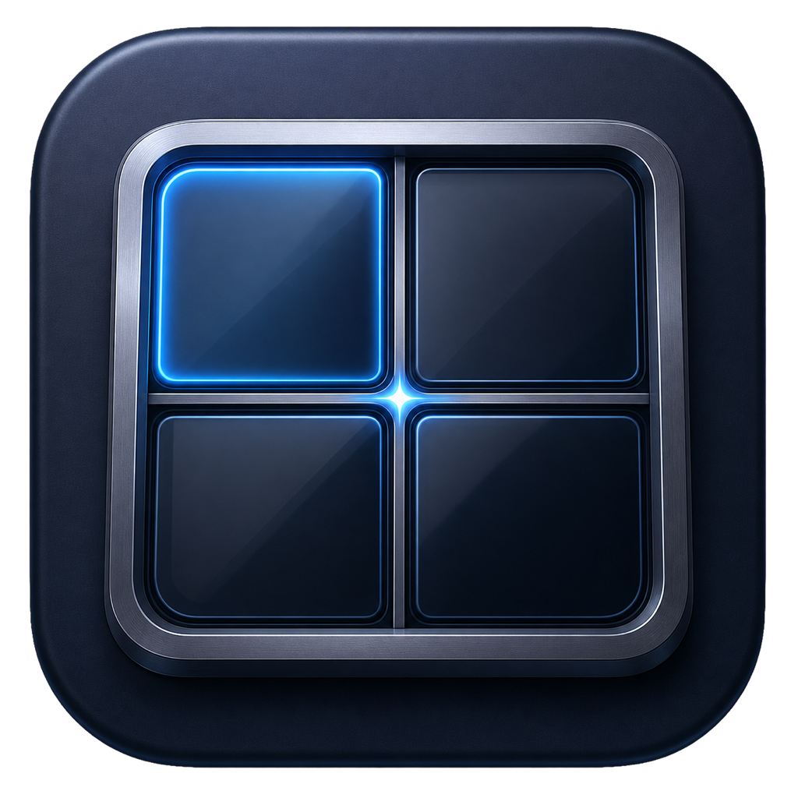
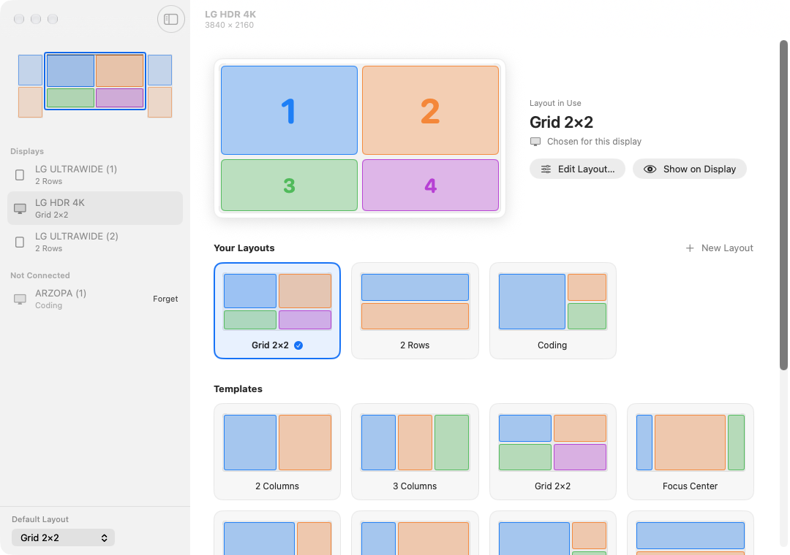
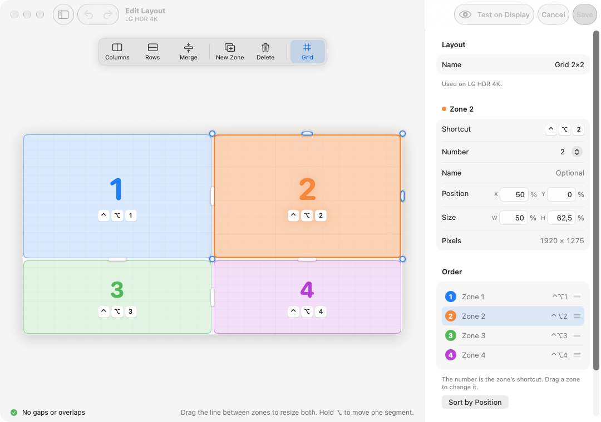
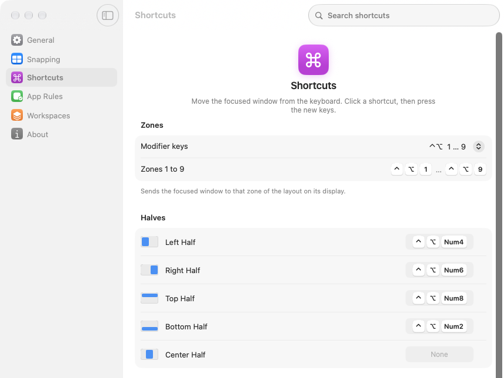
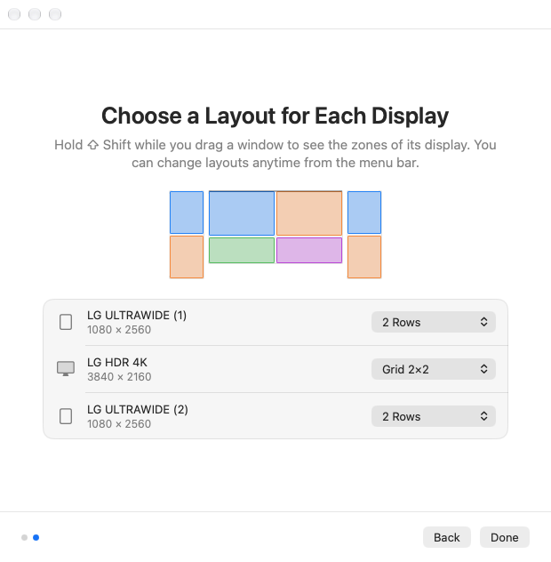
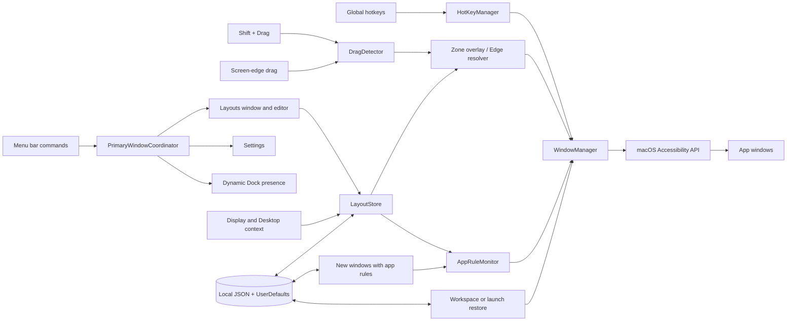

<p align="center">
  
</p>

<h1 align="center">EpycZones</h1>

<p align="center">
  Custom window layouts and fast snapping for macOS.
</p>

<p align="center">
  Native menu bar app · Shift + Drag · Edge snap · A layout for every display
</p>

<p align="center">
  <a href="https://github.com/ulissescomonian/epyczones/releases/tag/v1.1.0"></a>
  
  
  
  <a href="https://github.com/ulissescomonian/epyczones/releases/tag/v1.1.0"></a>
  <a href="https://github.com/ulissescomonian/epyczones/actions/workflows/ci.yml"></a>
  <a href="LICENSE"></a>
</p>

<p align="center">
  <a href="https://github.com/ulissescomonian/epyczones/releases/download/v1.1.0/EpycZones-1.1.0-arm64.dmg"><strong>Download EpycZones 1.1.0 for Apple Silicon (.dmg)</strong></a>
  <br>
  <a href="https://github.com/ulissescomonian/epyczones/releases/tag/v1.1.0">Release notes and SHA-256 checksum</a>
</p>

> [!IMPORTANT]
> EpycZones 1.1.0 is a Preview. The Apple Silicon app has a local code signature,
> not an Apple Developer ID signature. Neither the app nor the DMG is notarized
> by Apple. Install it only from a source you trust, and never disable
> Gatekeeper to open it.

## What EpycZones does

EpycZones brings the custom window layouts of Windows PowerToys
[FancyZones](https://learn.microsoft.com/en-us/windows/powertoys/fancyzones)
to macOS. Give each display a layout of zones, then snap windows into them
with a drag or a shortcut. A Desktop (macOS Space) can have a layout of its
own, and displays without one use your default layout.

It is a lightweight native menu bar app. EpycZones appears in the Dock while
the Layouts or Settings window is open or minimized, making it easy to return
to active work; it returns to menu-bar-only behavior after the last window
closes. The interface is in English and Brazilian Portuguese and follows the
language of macOS. There is no cloud service, account, telemetry, or
third-party Swift dependency.

## Highlights

- **Shift + Drag zones.** Hold Shift while dragging a window to see the zones
  of its display, preview the destination, and span two zones by dropping on
  the border between them. The key to hold is configurable.
- **Edge snap.** Drag to an edge or corner without a modifier for a half or a
  quarter of the screen. Edges shared by two displays are ignored, so moving a
  window to another display never snaps it on the way.
- **A layout for every display.** Each display keeps its own layout, and each
  Desktop can override it. Displays are recognized by their hardware ID, so a
  layout stays with its monitor across reconnections.
- **Layout editor.** Split zones into columns or rows, drag the line between
  zones to resize both, merge neighbors, and set the order that numbers their
  shortcuts. Undo and redo, a 24-step grid, and live checks for gaps and
  overlaps keep layouts clean.
- **Nine templates.** Start from columns, rows, a grid, or a focus layout.
  Customizing a template saves your own copy, so templates never change.
- **Keyboard first.** More than 30 positions with rebindable shortcuts,
  shortcuts for zones 1 to 9 with the modifier keys you choose, width cycling,
  and display flow on repeated halves.
- **App rules.** Open every new window of an app in the same position or zone.
- **Workspaces and restore.** Save where your windows are and put them back
  with one click. At launch, windows you snapped to a zone go back to it. Both
  work with the Accessibility permission alone.
- **Welcome guide.** The first launch walks through the Accessibility
  permission and suggests a layout for each display by its shape.

## Screenshots

<table>
  <tr>
    <td align="center"><strong>Layouts</strong></td>
    <td align="center"><strong>Layout Editor</strong></td>
  </tr>
  <tr>
    <td>
      <picture>
        <source media="(prefers-color-scheme: dark)" srcset="screenshots/layouts-dark.png">
        
      </picture>
    </td>
    <td>
      <picture>
        <source media="(prefers-color-scheme: dark)" srcset="screenshots/editor-dark.png">
        
      </picture>
    </td>
  </tr>
  <tr>
    <td align="center"><strong>Shortcuts</strong></td>
    <td align="center"><strong>Welcome</strong></td>
  </tr>
  <tr>
    <td>
      <picture>
        <source media="(prefers-color-scheme: dark)" srcset="screenshots/shortcuts-dark.png">
        
      </picture>
    </td>
    <td>
      <picture>
        <source media="(prefers-color-scheme: dark)" srcset="screenshots/welcome-dark.png">
        
      </picture>
    </td>
  </tr>
</table>

## Requirements

- macOS 14 Sonoma or later.
- Apple Silicon (`arm64`) for the distributed Preview DMG.
- Accessibility permission to inspect, move, and resize other applications'
  windows.
- Xcode or Xcode Command Line Tools with Swift 5.9 or later only when building
  from source.

The distributed DMG is not universal and does not run natively on Intel Macs.

## Install the Preview DMG

1. Download `EpycZones-1.1.0-arm64.dmg` and
   `EpycZones-1.1.0-arm64.dmg.sha256` from the same trusted
   [v1.1.0 Release](https://github.com/ulissescomonian/epyczones/releases/tag/v1.1.0).
2. Optionally verify the download in Terminal:

   ```bash
   cd ~/Downloads
   shasum -a 256 -c EpycZones-1.1.0-arm64.dmg.sha256
   ```

3. Open the DMG and drag **EpycZones.app** to **Applications**.
4. Eject the DMG.
5. In Finder, open **Applications**, Control-click EpycZones, choose **Open**,
   then confirm **Open**.

If macOS still blocks the first launch, open **System Settings → Privacy &
Security** and choose **Open Anyway** for EpycZones. The wording may vary by
macOS version. Do not disable Gatekeeper globally and do not remove quarantine
metadata as an installation shortcut.

### Updating from 1.0

Quit EpycZones from its menu, then replace the app in **Applications** with
the new one. Version 1.1.0 keeps the signing identity and bundle identifier of
1.0.1, so macOS keeps the Accessibility permission. Your layouts, display
assignments, app rules, and workspaces carry over; assignments made by display
name move to the display's hardware ID the first time that display is
connected.

### Accessibility permission

On first launch, a welcome guide asks for Accessibility access and shows when
macOS grants it. Turn EpycZones on under **System Settings → Privacy &
Security → Accessibility**. Without this permission, EpycZones cannot read,
move, or resize windows from other applications.

If macOS turns the permission off later, as it can after an update, the menu
bar icon becomes a warning triangle and the guide opens again with that single
step.

### What the Preview signature means

The app has a local code signature so macOS can verify the internal integrity
of its bundle. It has no Apple Team ID, is not Developer ID signed, and is not
notarized. The DMG is also not signed or notarized. A local signer label in
`codesign` output is not an Apple trust assertion.

You can inspect an installed copy without modifying it:

```bash
codesign --verify --deep --strict /Applications/EpycZones.app
codesign -dv --verbose=4 /Applications/EpycZones.app
file /Applications/EpycZones.app/Contents/MacOS/EpycZones
```

## Using EpycZones

### Shift + Drag

Hold **Shift** while dragging a window. The layout of the display under the
pointer appears, with a ghost preview of the destination. Release to snap or
press **Esc** to cancel. Drop near the border between two zones to span both;
a window that spans zones is not restored to a single zone at launch. Choose
another key under **Settings → Snapping**.

### Edge snap

Drag a window near a display edge or corner without holding a modifier. After
the configured delay, EpycZones previews a half or a quarter. Releasing snaps
the window; moving away or pressing **Esc** cancels it. The top edge can
maximize instead of selecting the top half, and edges shared with another
display are ignored unless you turn that off.

The default edge threshold is 30 points and the default delay is 0.2 seconds.
Both are configurable under **Settings → Snapping**.

### Layouts, displays, and Desktops

Choose **Layouts…** in the menu bar menu. The window shows your displays as
they are arranged in System Settings. Select one to see its layout, then pick
another from **Your Layouts** or **Templates**. Each display also has a
submenu in the menu bar menu for switching layouts without opening the window.

EpycZones includes nine templates: **2 Columns**, **3 Columns**, **Grid 2×2**,
**Focus Center**, **Priority Left**, **Priority Right**, **Main and Stack**,
**2 Rows**, and **3 Rows**. Customizing a template saves a copy in Your
Layouts and leaves the template as it was.

The layout used on a display follows this priority:

1. the layout chosen for the current Desktop on that display;
2. the layout chosen for the display;
3. the default layout.

**Cycle Layout** (`⌃⌥ L`) switches the display of the focused window to its
next layout. Moving a window to another display preserves its relative frame.
EpycZones never moves windows between Desktops.

### The layout editor

Select a layout and choose **Edit** or **Customize**. The editor opens with the
shape of the display you are working on and changes nothing until you save.

- **Columns** and **Rows** split the selected zone in two. **Merge** joins it
  with a neighbor that shares a whole edge.
- Drag the line between zones to resize both sides. Hold **Option** to move a
  single segment of a longer line.
- Drag a zone or its handles for free placement, or type exact positions and
  sizes in the inspector.
- Drag rows in the inspector's **Order** list to renumber zones. The number is
  the zone's shortcut.
- **Checks** lists areas that no zone covers, overlaps, and zones without a
  shortcut.
- **Tab** moves between zones, the arrow keys nudge the selected one, and
  **Delete** removes it. `⌘Z`, `⇧⌘Z`, and `⌘S` undo, redo, and save.
- **Test on Display** shows the zones on the real display for a moment.

### App rules and workspaces

An app rule applies to new standard windows from a selected application. Each
app can have one rule, targeting a built-in position or one of the zones 1 to
9 of the layout on the display where the window opens.

A workspace records the bundle identifier, window title, display, and relative
frame of visible windows. Restoring a workspace moves matching windows that are
already open; it does not launch applications.

## Default keyboard shortcuts

Named actions use **⌃⌥** (Control + Option) by default and can be changed under
**Settings → Shortcuts**.

| Shortcut | Action |
|----------|--------|
| `⌃⌥ Num4` / `⌃⌥ Num6` | Left / right half, with repeated width cycling |
| `⌃⌥ Num8` / `⌃⌥ Num2` | Top / bottom half |
| `⌃⌥ U` / `⌃⌥ I` | Top-left / top-right quarter |
| `⌃⌥ J` / `⌃⌥ K` | Bottom-left / bottom-right quarter |
| `⌃⌥ D` / `⌃⌥ F` / `⌃⌥ G` | First / center / last third |
| `⌃⌥ E` / `⌃⌥ R` / `⌃⌥ T` | First / center / last two-thirds |
| `⌃⌥ Return` | Maximize |
| `⌃⌥ H` | Maximize height |
| `⌃⌥ Num5` | Center |
| `⌃⌥ -` / `⌃⌥ =` | Make smaller / larger, within the display |
| `⌃⌥ Delete` | Restore previous in-memory frame |
| `⌃⌥ Num7` / `⌃⌥ Num9` | Dock left / dock right |
| `⌃⌥ N` / `⌃⌥ P` | Next / previous display |
| `⌃⌥ L` | Cycle layout |
| `⌃⌥ 1` … `⌃⌥ 9` | Snap to zone 1 … 9 of the display's layout |

Zone shortcuts 1 to 9 use the same keys with the modifiers chosen under
**Settings → Shortcuts**: ⌃⌥ by default, or ⌃⌘, ⌥⌘, ⌃⇧, or ⌃⌥⌘. Fourths,
sixths, center half, and almost maximize begin without a default binding.

## How It Works



| Component | Responsibility |
|-----------|----------------|
| `HotKeyManager` | Registers system-wide shortcuts with Carbon. |
| `DragDetector` | Observes local and global pointer events for zone and edge snapping. |
| `ZoneOverlayController` / `SnapPreviewController` | Present floating, non-activating zone and destination previews. |
| `LayoutStore` | Stores layouts and resolves Desktop, display, and default layout precedence. |
| `LayoutGeometry` / `LayoutEditSession` | Split, merge, and divider geometry, and the editor's undoable session. |
| `WindowManager` | Reads and applies window frames through the Accessibility API. |
| `AppRuleMonitor` | Watches selected applications for new standard windows. |
| `WorkspaceManager` / `WindowPersistence` | Save local arrangements and restore matching open windows. |
| `PrimaryWindowCoordinator` | Opens or focuses one Layouts/Settings window and synchronizes dynamic Dock presence. |

Desktop-aware layout selection uses private Core Graphics Services APIs. This
may require maintenance after future macOS updates. There is no network or
cloud path in the application.

## Local data and privacy

EpycZones has no analytics, telemetry, account system, network client, or cloud
sync. Its state remains on the Mac in `UserDefaults` and JSON files under:

```text
~/Library/Application Support/EpycZones/
├── app-rules.json
├── layouts.json
├── window-zones.json
└── workspaces.json
```

`layouts.json` holds your layouts and the names and hardware IDs of displays
you assigned layouts to. Workspace and restore files can contain application
bundle identifiers, display names, and window titles. None of these files are
encrypted. Treat them as local private data and include them deliberately when
making backups.

## Known limitations

- The current release is Apple Silicon only, locally signed, and not notarized.
- Desktop mapping depends on private macOS APIs and may change in a future
  macOS release. EpycZones does not move windows between Desktops.
- Workspace restore does not launch apps; matching windows must already exist.
- Some apps enforce minimum sizes, use non-standard windows, or refuse
  Accessibility frame changes.
- Restoring a window's previous frame (`⌃⌥ Delete`) is in memory and limited
  to recent frames.
- EpycZones has no automatic updater. Unit tests cover geometry, layout
  editing, layout selection, and translations; window movement through
  Accessibility is validated manually.

## Build and package from source

```bash
git clone https://github.com/ulissescomonian/EpycZones.git
cd EpycZones
make debug
make test
make bundle
```

`make bundle` creates a local development bundle at `.build/EpycZones.app`.
It is useful for manual testing and may use an ad-hoc signature, so it is not a
release artifact and must not be distributed. To create a release DMG and
checksum, the release signing identity is required:

```bash
make dmg
```

The distributable files are written to `dist/`. Release packaging fails if the
stable `EpycZones Dev` identity is unavailable; it never substitutes an ad-hoc
signature. Packaging does not notarize the app or DMG.

## Project structure

```text
Sources/EpycZones/
├── EpycZonesApp.swift          # App entry point and scenes
├── AppDelegate.swift           # Lifecycle and Accessibility setup
├── MenuBarView.swift           # Menu bar menu with a submenu per display
├── WelcomeView.swift           # First-run guide
├── PrimaryWindowCoordinator.swift # Singleton windows and dynamic Dock presence
├── WindowManager.swift         # Accessibility window operations
├── DragDetector.swift          # Shift + Drag and edge detection
├── HotKeyManager.swift         # Carbon shortcut registration
├── LayoutStore.swift           # Layout persistence and precedence
├── LayoutsView.swift           # Layouts window: displays and libraries
├── LayoutEditorView.swift      # Layout editor and inspector
├── ZoneCanvasView.swift        # Editor canvas
├── LayoutGeometry.swift        # Split, merge, and divider geometry
├── LayoutEditSession.swift     # Undoable editing session
├── ZoneOverlayController.swift # Zone overlay and spanning preview
├── AppRuleMonitor.swift        # New-window rules
├── WorkspaceManager.swift      # Workspace capture and restore
└── SettingsView.swift          # Settings window and its panes

Resources/                      # App icon, Info.plist, and string catalog
screenshots/                    # README images
scripts/                        # Reproducible app and DMG packaging
```

See [CONTRIBUTING.md](CONTRIBUTING.md) for the development workflow and
[SECURITY.md](SECURITY.md) for vulnerability reporting and the Preview trust
model. Repository-specific agent instructions live only in
[AGENTS.md](AGENTS.md).

## Release notes

EpycZones 1.1.0 redesigns the Layouts window, the layout editor, Settings, and
the menu bar menu, and adds a welcome guide and a Brazilian Portuguese
translation. Layouts are chosen per display, with a default layout for the
rest, and the editor gains splitting, merging, shared dividers, undo, and
layout checks. It also fixes Shift + Drag targeting and hotkey recording,
restores windows and workspaces with the Accessibility permission alone, and
keeps Make Larger and Make Smaller inside the display. It preserves the stable
app identity of 1.0.1, so the Accessibility permission carries over.

See the [EpycZones 1.1.0 Release](https://github.com/ulissescomonian/epyczones/releases/tag/v1.1.0)
for the download, SHA-256 checksum, installation notes, and known limitations.

## Acknowledgments

Inspired by [FancyZones](https://learn.microsoft.com/en-us/windows/powertoys/fancyzones)
from Microsoft PowerToys.

## License

[MIT License](LICENSE) — free to use, modify, and distribute.
